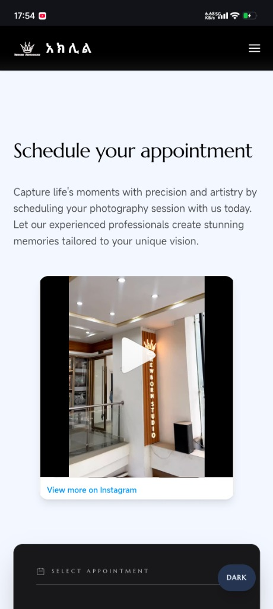
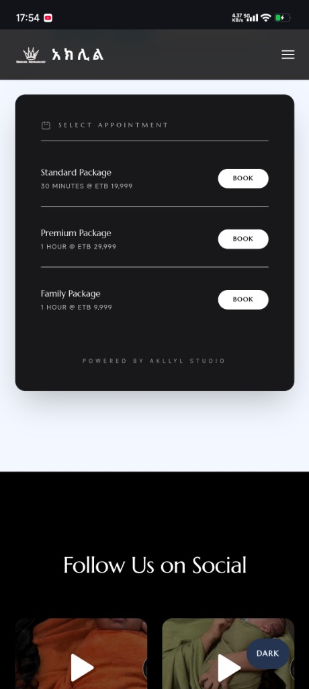
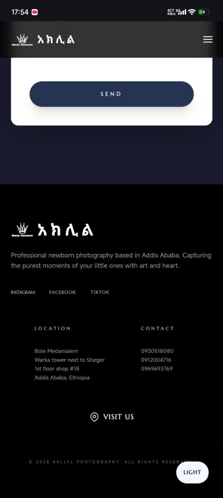

# Akllyl Newborn Photography

A modern, responsive website for Akllyl Newborn Photography Studio based in Addis Ababa, Ethiopia.

## Screenshots

  
  
  

## Features

- **Dark/Light Mode** - Seamless theme switching
- **Responsive Design** - Optimized for mobile and desktop
- **Social Media Embeds** - TikTok and Instagram video integration
- **Appointment Booking** - Package selection with pricing
- **Google Maps Integration** - Location links for easy navigation
- **Smooth Animations** - Fade-in and slide effects

## Tech Stack

- **Framework**: Next.js 15 (App Router)
- **Styling**: Tailwind CSS v4
- **Language**: TypeScript
- **Font**: Marcellus (serif)
